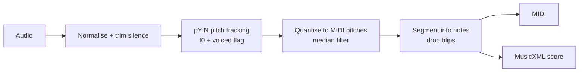

# AI-Powered MIDI Transcription

[](https://github.com/Victus0904/AI-Powered-MIDI-Transcription-Generation/actions/workflows/ci.yml)


[](LICENSE)

Turn a recording of a melody (a voice, flute, violin, whistle and so on) into an
**editable MIDI file** and, optionally, **sheet music (MusicXML)**. You can then open
the result in FL Studio, Ableton, GarageBand, MuseScore or any other DAW or notation editor.

## How it works



1. **Pitch tracking.** librosa's probabilistic YIN (pYIN) estimates the fundamental frequency of every frame and whether the frame is voiced.
2. **Quantisation.** Voiced frames are rounded to the nearest MIDI note; unvoiced frames are rests.
3. **Clean-up.** A median filter removes single-frame pitch glitches, and notes shorter than `--min-note` (80 ms by default) are dropped.
4. **Segmentation.** Consecutive frames with the same pitch become one note with real start and end times, so durations follow the performance instead of a fixed grid.
5. **Export.** `pretty_midi` writes the MIDI file and `music21` writes a MusicXML score quantised to 16th notes.

## Quick start

```bash
git clone https://github.com/Victus0904/AI-Powered-MIDI-Transcription-Generation.git
cd AI-Powered-MIDI-Transcription-Generation
pip install -r requirements.txt

python transcribe.py melody.wav                         # -> melody.mid
python transcribe.py melody.mp3 -o out.mid --xml out.musicxml --program 73   # flute
```

| Option | Default | Meaning |
|---|---|---|
| `-o, --output` | `<input>.mid` | MIDI output path |
| `--xml` | none | Also write a MusicXML score |
| `--program` | `0` (piano) | General MIDI instrument |
| `--min-note` | `0.08` | Shortest note kept, in seconds |
| `--bpm` | `120` | Tempo used to quantise the score |

From Python:

```python
from transcribe import transcribe, write_midi
notes = transcribe("melody.wav")      # [Note(pitch=69, start=0.0, end=0.58), ...]
write_midi(notes, "melody.mid")
```

## Notebook

`AI_Powered_MIDI_Transcription_&_Generation.ipynb` is the original exploration
(YIN pitch tracking, plots and a first MIDI/score export). `transcribe.py` is the
cleaned-up, tested version of that pipeline. It treats silence as rests rather than
as low notes, and it builds notes from their real durations.

## Limitations

- **Monophonic only.** Chords and multiple instruments need a polyphonic model such as Basic Pitch or Onsets and Frames.
- Repeated notes of the same pitch with no gap between them are merged into one note.
- Accuracy depends on recording quality; reverb and background noise hurt pitch tracking.

## Running the tests

```bash
pip install pytest
pytest -q
```

The tests synthesise tones (A4 then C5) and check that they come back as MIDI notes 69 and 72.

## License

[MIT](LICENSE)
